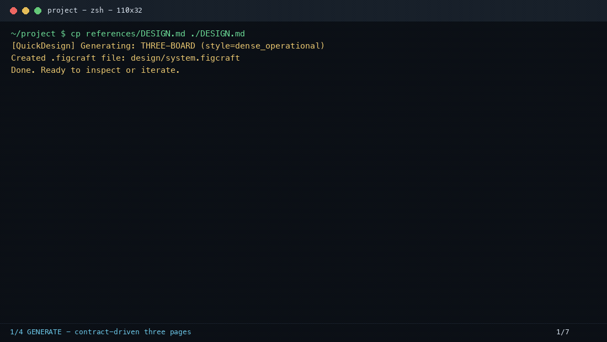
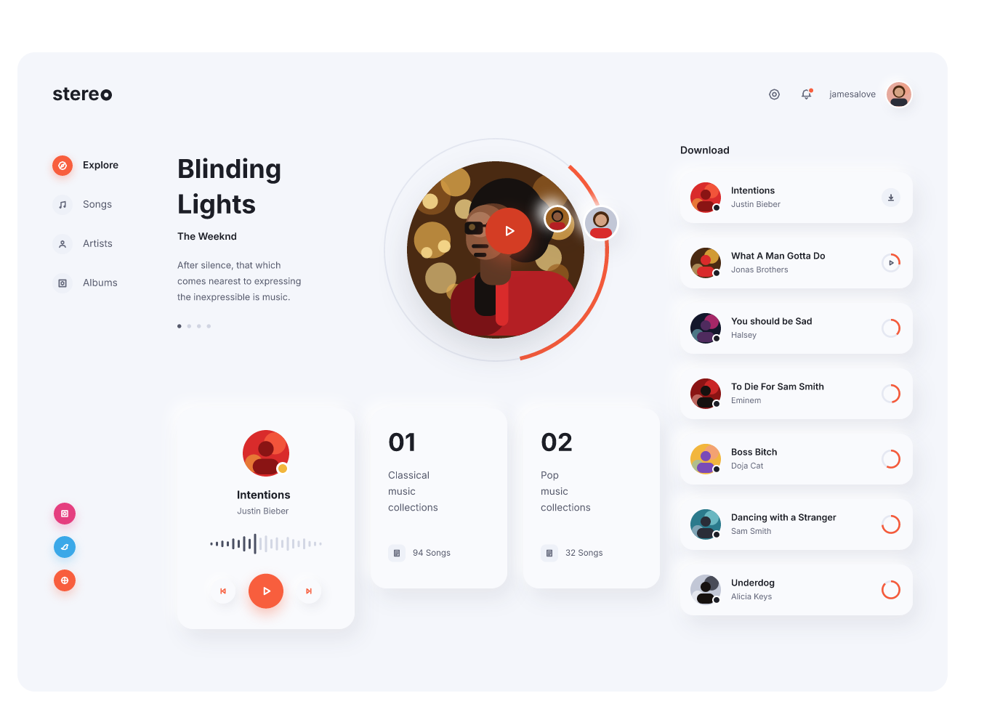
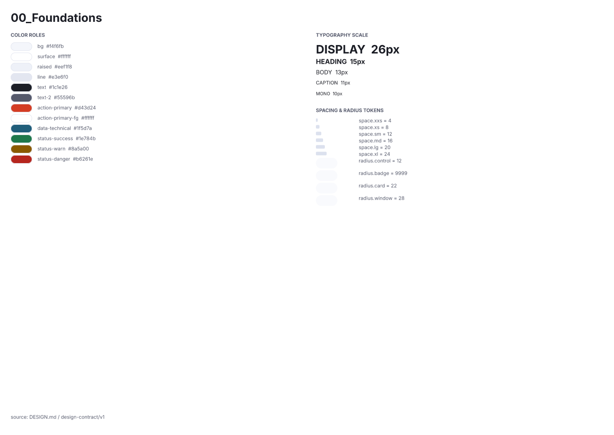
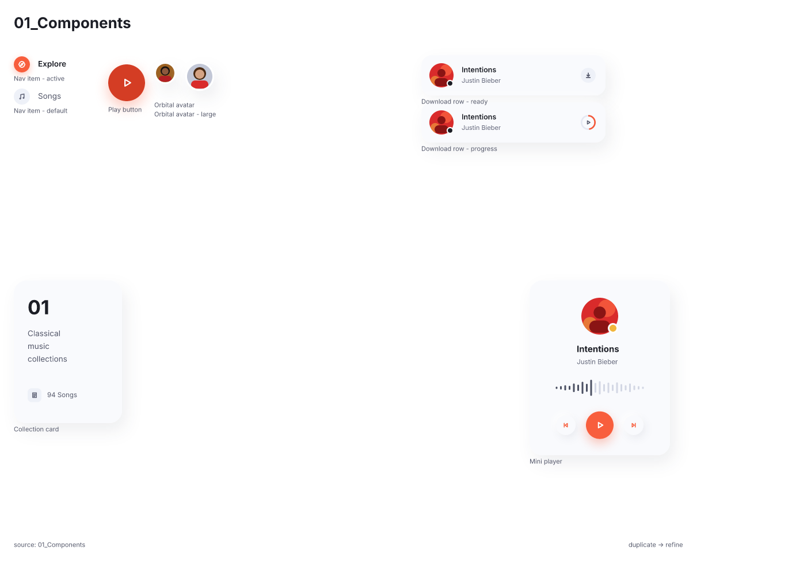

# kuron-design-figcraft

`kuron-design-figcraft` is an AI product and UI design skill with a small Python toolkit for building multi-page `.figcraft` design systems. Your project's `DESIGN.md` is the contract: it decides colours, typography, spacing, and style direction, so every screen follows the same rules instead of guesswork. The toolkit then exports PNGs and audits them, because a design is not finished until it has actually been seen.

It works with Claude Code, Codex, OpenCode, Cursor, and Orca. It needs no credentials, no private paths, and no third-party Python packages.

---

## See it in action

Watch the real v3.2.1 workflow — Generate → Live Terminal → Live Editing → Live Audit & Export:



These screens were generated from a single `.figcraft` document. Each board lives on its own page and is exported from that page, much like organising a Figma file.



The finished screen is assembled from reusable pieces built on the two earlier pages:





The order is **Foundations → Components → Screens**: define the tokens once, build the components once, then assemble screens by copying and refining those components.

---

## Core concepts

### 1. One contract: `DESIGN.md`

Every project has a `DESIGN.md` that is the single source of truth for colour, typography, spacing, radius, motion, accessibility, states, and style direction. It carries a small JSON block (`design-contract/v1`) that the scripts can read. Choose one of four directions — `dense_operational`, `bento_modular`, `editorial`, or `clean_utility` — or define your own `custom` direction. A missing or invalid contract stops with a clear error rather than silently falling back to a preset.

```json
{
  "$schema": "kuron-design-figcraft/design-contract/v1",
  "style_direction": "bento_modular",
  "default_theme": "dark",
  "locale": "en-US",
  "tokens": {
    "primitive": { "color": { "brand": {"dark": "#...", "light": "#..."}} },
    "semantic": { "color": { "action-primary": "$primitive.color.brand" } },
    "component": { "button": { "height": {"md": 32} } }
  },
  "a11y": { "minContrast": "AA", "minTouchTargetPx": 44 },
  "states": ["default", "hover", "focus", "disabled", "empty", "loading", "error", "success"]
}
```

Token layers run `primitive → semantic → component → theme/state`. Components reference roles such as `action-primary` instead of raw hex values, so a colour can be changed in one place and applied everywhere.

### 2. A multi-page, Figma-style workflow

`00_Foundations` → `01_Components` → `02_Screens` are separate pages in one document. When a screen needs a navigation item, a card, or a download row, the toolkit copies the existing component onto the screens page and refines that copy — it does not rebuild it. This "copy, then refine" approach keeps screens consistent and makes a change to a component available to every screen that uses it.

### 3. Automated quality and visual review

An automated render audit runs on every page. It checks that labels and captions are descriptive English, that cards contain and fit their content, that text does not overflow, clip, or overlap, and that colour contrast meets AA or AAA. Alongside that audit, a **3–5× verification loop** asks you to export a PNG and inspect it after each change: at least three clean passes are required before a design is called done.

---

## Design Approach (2026 standard)

The skill behaves like a product designer rather than a screen generator:

1. **Start with the problem.** Establish the app type, audience, main problem, and desired outcome, then offer two or three layout directions for the user to choose from. The decision is recorded in `DESIGN.md` before any pixels are drawn.
2. **Design complete experiences.** Screens include real empty, loading, error, disabled, focus, and success states, useful microcopy, and accessible composition — not placeholder screens.
3. **Reuse before rebuilding.** Build components once on `01_Components`, then duplicate and refine them on `02_Screens`.
4. **Work decisively and verify.** Keep build cycles short and focused, then rely on the automated checks and PNG review above.

Full details live in `references/product-designer-2026.md`, `references/style-directions.md`, and `references/token-architecture.md`.

---

## Quick start

### Install the skill

Run the bundled installer with the skills directory of your harness:

```bash
bash install.sh ~/.claude/skills/kuron-design-figcraft
```

`DEST` is the full path of the installed skill directory (for example
`~/.claude/skills/kuron-design-figcraft`). Typical targets are Claude Code
(`~/.claude/skills/`), Codex (`~/.codex/skills/`), OpenCode
(`~/.config/opencode/skills/`), Cursor (`~/.cursor/skills/`), and your Orca
agent's `skills/` folder. With no argument, `install.sh` uses
`~/.claude/skills/kuron-design-figcraft`. Use `bash install.sh --help` for
options and `--dry-run` to preview the target without copying files. You can
also copy this whole folder into the target skills directory yourself — the
installer only adds version checks, asset copying, and a test run.

### Build a design from scratch

Run these commands from the package root (or the installed skill folder):

```bash
# 1. Put a DESIGN.md in your project: copy the valid starter, then edit its JSON block.
#    The starter passes json.loads() + validate() on first run.
cp references/DESIGN.md ./DESIGN.md
#    choose style_direction, map action-primary/data-technical, set a11y and states

# 2. Generate a design and a first preview PNG.
python3 scripts/quick_design.py "three-page design system" -p three-pages -o out/system.figcraft
python3 scripts/quick_design.py "Project dashboard" -o out/workbench.figcraft --preview
#    generate a single artifact instead: --generate components | screen | form

# 3. Open a live session, discover real node IDs, edit, and export PNGs.
python3 scripts/agent_terminal.py --port 9880 start --file out/workbench.figcraft
python3 scripts/agent_terminal.py --port 9880 frames
python3 scripts/agent_terminal.py --port 9880 export-all -o out/previews/ --scale 2
python3 scripts/agent_terminal.py --port 9880 stop

# 4. Audit the render and run the test suite.
python3 scripts/audit_render.py out/workbench.figcraft
```

`--port` is a global option and must come before the subcommand; `9880` is only a default. Set `FIGCRAFT_APP` for a non-default app binary, `FIGCRAFT_DESIGN` for the working file, and `FIGCRAFT_DESIGN_MANIFEST` if your `DESIGN.md` lives somewhere unusual. `watch` does not modify the source `.figcraft`: it soft-reloads the live session and writes exported PNGs to the output folder. `frames --json` is a deprecated compatibility no-op — the command already prints JSON.

---

## Repository layout

| Path | What it contains |
|---|---|
| `SKILL.md` | Short entry point with the rules the AI agent follows, plus version metadata |
| `references/` | Detailed specifications: the `DESIGN.md` template, token layers, style directions, layout rules, and live-editing workflow |
| `scripts/` | Python toolkit: generator, builders, live terminal bridge, render auditor, and design-contract resolver |
| `tests/` | Standard-library tests covering builders, contracts, layout, multi-page saves, fail-closed discovery, and package hygiene |

Other files at the root: `DESIGN.md` (this package's own preset), `install.sh`, `CHANGELOG.md`, `CONTRIBUTING.md` (maintainer workflow), `VERSION`, `LICENSE`, and the showcase PNGs under `docs/assets/showcase/`.

---

## Running tests

```bash
python3 -m unittest discover -s tests -p 'test_*.py' -v
```

All tests use the Python standard library — no third-party dependencies, no network, and no credentials. `install.sh` runs the same command from the installed directory (with `python3 -B`) to confirm a clean, cache-free installation.

---

## Troubleshooting

- **`No DESIGN.md found` / fail-closed error.** Scripts never fall back to the
  skill's bundled manifest. Copy the valid starter into your project root with
  `cp references/DESIGN.md ./DESIGN.md`, or set `FIGCRAFT_DESIGN_MANIFEST` to an
  explicit path. The error lists every directory it searched.
- **FigCraft binary not found on Linux.** The default binary path is macOS-only.
  Set `FIGCRAFT_APP=/path/to/figcraft-executable` before `start`; builders,
  linting, validation, and the audit work offline without it.
- **Port busy or stale session.** Run `status` first; if the socket is dead,
  `stop` and `start` again or pass a different `--port`. PID/port files live in
  the current working directory.
- **Watch appears to do nothing to the file.** By design: `watch` never edits
  the `.figcraft` source; it soft-reloads the live session and writes PNGs to
  the output folder. Check that folder, and keep `--max-events` /
  `--max-seconds` bounded.
- **Broken preview or export.** Pass `--page-index` / `--page-name` to inspect a
  page other than `pages[0]`; the source document is never rewritten.

---

## Limitations

- **Live rendering needs FigCraft.** PNG preview and export talk to a FigCraft app or CLI installed on your machine. The generators, contract validation, linting, and audit run without it; `--preview` simply reports "Preview not generated" when no renderer is available. The closed-source engine itself is not bundled.
- **The live canvas opens `pages[0]`.** The first page (`00_Foundations`) is what the app displays by default. The document keeps every page, and the toolkit can inspect, audit, and export any page using `--page-index` or `--page-name`. For a page other than the first, it builds a temporary read-only view for the engine and removes it afterwards — your source file is never rewritten.
- **One writer at a time.** Only one process should write a given `.figcraft` file. The live watcher is read-only and deliberately time-bounded.
- **Your project owns the decisions.** There is no hidden brand or colour palette: values come from `DESIGN.md`, and the tools fail with an actionable message when it is missing.

---

## License

MIT — see [LICENSE](LICENSE).
